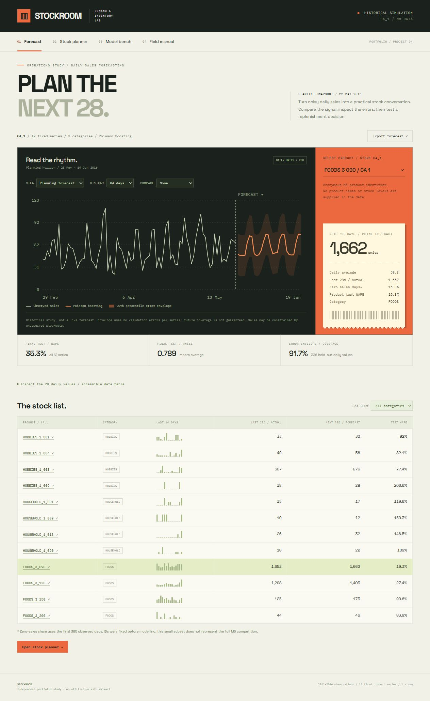

# STOCKROOM / Demand & Inventory Lab

[](https://github.com/Boody700/stockroom-demand-lab/actions/workflows/checks.yml)

**Demand forecasting with rolling validation, baseline comparisons and inspectable stock scenarios.**

[Case study](docs/case-study.md) · [Interview notes](docs/interview-guide.md) · [Validation workflow](.github/workflows/checks.yml)

An end-to-end time-series portfolio project: forecast daily retail sales, compare simple baselines honestly, and expose the operational assumptions behind a suggested replenishment order.

**[Open the private interactive demo](https://stockroom-abdelrahman-2026.solarcorgi36.chatgpt.site)**



## What you can do

- Explore 12 fixed M5 product series from store CA_1, with 1,941 days of observed sales each.
- Inspect 28-day forecasts, empirical error envelopes and held-out actuals.
- Overlay weekly, 28-day-repeat and trailing-mean baselines; select products and filter the stock list.
- Adjust illustrative stock, pipeline, backlog, lead time, review cycle, safety buffer and demand stress.
- See order arithmetic, delivery timing and daily projected inventory/backlog, with and without the suggested order.
- Export forecasts, scenario inputs/movements and full model evaluation. Exact chart values are available in accessible tables.

## Results

The fixed Poisson histogram gradient boosting candidate won on two rolling validation windows: **55.0% pooled validation WAPE**, compared with 67.4% for a weekly repeat. No parameters were adjusted after inspecting final-test outcomes.

Final test: **25 April–22 May 2016**, 12 series × 28 daily values.

| Selected model metric | Result |
|---|---:|
| WAPE | 35.27% |
| Daily MAE | 3.679 units |
| Macro RMSSE | 0.789 |
| Relative bias | +6.08% |
| Empirical error-envelope coverage | 91.67% |

WAPE is error, not accuracy. RMSSE here is unweighted across series, not the official M5 hierarchical score. Coverage is an observed diagnostic, not a guarantee. Full candidate scores and version/hash provenance are in [evaluation.json](reports/evaluation.json).

## Run the prebuilt app

Node.js 22+; no npm dependency installation is needed.

```powershell
npm start
```

Open `http://127.0.0.1:4176`. Alternatively, serve `dist/` with any static HTTP server. Opening `index.html` as a file will not load JSON modules reliably.

## Reproduce the data and model

Python 3.11+ is recommended. The pinned environment used here is recorded in the report. No GPU, API key, paid service or saved model binary is required.

```powershell
python -m venv .venv
.venv/Scripts/python -m pip install -r requirements.txt
.venv/Scripts/python scripts/download.py
.venv/Scripts/python scripts/train.py
.venv/Scripts/python -m unittest discover -s tests -p "test_*.py"
npm test
```

On Linux/macOS, use `.venv/bin/python`. The downloader streams the large source CSV and stores only the 12 fixed rows; it saves a small calendar and selection manifest. The included derived subset allows reproduction without another download. Training regenerates `dist/data/forecast.json`, `reports/evaluation.json` and `reports/forecast.csv`. Small numerical differences can occur across platforms/library builds; the supplied report preserves the original run.

Seven Python checks include future-label invariance (including ML retraining), target-free feature windows, selection, metrics, checksums and validation-only envelopes. Nine Node checks cover inventory accounting, arrival timing, early shortage, exclusion of the proposed order, stress, input bounds and export escaping. GitHub Actions validates the committed browser planner and forecast fixtures.

## How it works

The three baselines and pooled Poisson boosting candidate forecast recursively over 28 days. Training uses only values before the origin. Weekday, month, calendar-event and SNAP features are known calendar inputs. Validation origins are days 1,857 and 1,885; the final-test origin is day 1,913. The selected model is refitted through day 1,941 for a **historical planning horizon of 23 May–19 June 2016**.

The 90th percentile of 56 validation absolute errors per product defines a symmetric error radius, clipped at zero. This is an empirical envelope; time dependence and changing sales patterns limit its coverage interpretation.

Inventory policy: target the sum of forecast sales over lead + review + safety-buffer days, rounded up. Subtract the inventory position (on hand + on order − backlog), then clamp the suggested order at zero. Existing and new orders arrive once, at the start of the lead-time day. The simulator carries negative units as backlog and does not place later review orders.

## Scope and attribution

Data: [M5 dataset, Zenodo / University of Nicosia](https://zenodo.org/records/10203108), originating from the [M5 forecasting competition](https://www.kaggle.com/competitions/m5-forecasting-accuracy); see also the [organizer repository](https://github.com/Mcompetitions/M5-methods). Dataset files retain their original terms and are not relicensed by this project's MIT code license. See [third-party notices](THIRD_PARTY_NOTICES.md).

This is an independent portfolio study, not an affiliated Walmart product. Product IDs are anonymous. Stock quantities are illustrative inputs. Sales are not necessarily unconstrained demand. The study makes no claim of real inventory savings, profit uplift, production validation or full-competition performance. The website is static and sends no scenario inputs to an inference service.

## Project guide

The [shareable evaluation figure](reports/evaluation.png) contrasts rolling validation, final test and per-product errors. To regenerate it, install `requirements-report.txt` and run `python scripts/plot_report.py`; this optional plotting dependency is not needed for training or the app.

- [Case study](docs/case-study.md)
- [Model and data card](docs/model-data-card.md)
- [Architecture and reproduction](docs/architecture.md)
- [Interview guide](docs/interview-guide.md)
- [Validation record](docs/validation.md)

Before presenting it, rerun it, inspect its failures and explain the assumptions in your own words.


## Development

Independent educational portfolio project. The source, evaluation design and limitations are documented so the work can be inspected and reproduced. GitHub Actions runs the committed browser checks. Python pipeline reproduction uses the commands and data sources described above.
